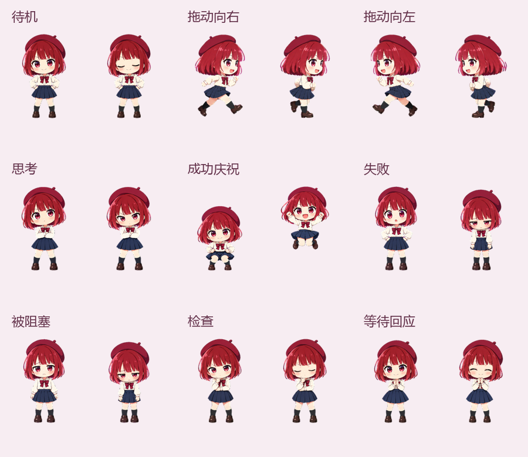

# 有马加奈 GPT 完整主题包

三套全界面皮肤 · 迷你加奈 Pet · 页面内嵌互动挂件 · 主题快速切换 · 安装与验收

面向 Windows 桌面版 ChatGPT / Codex 的非官方同人主题项目。除了背景，还包含侧边栏、输入区、卡片、菜单和弹窗等界面的主题适配，以及随工作状态变化的 Pet 和与主题联动的挂件。

**发布版本：2026.10.18.1｜挂件版本：embedded-3.6.0｜默认主题：红幕 · 星光舞台**

## 本次更新

- 重新整理 README 配图，删除含聊天、侧边栏记录和真实额度数据的旧截图。
- 三套主题分别展示对应背景，挂件与 Pet 图片放在各自介绍下，补齐蓝调主题配图。
- 发布图片只保留主题原始素材、Pet 动作图与纯角色动画；完整主题包同步更新。

本次为文档与隐私清理更新，主题功能和安装逻辑沿用 2026.10.17.1。简短发布文案见 [更新说明](更新说明.md)。

## 配图说明

本文所有图片仅展示主题相关素材，不展示真实账号、会话、侧边栏记录、用量统计或应用窗口。三套大图是包内原始背景，徽章图是挂件的主题头像素材，Pet 图展示角色动作；**它们不是完整应用界面截图**。实际界面布局取决于桌面应用版本和窗口尺寸。

## 三套主题

### 红幕 · 星光舞台

酒红、玫粉与金色，搭配舞台帷幕和星光背景；面板采用深色半透明质感。本包安装后默认应用这一套。


### 樱色 · 放学手记

奶白、樱粉与玫瑰红，搭配校园樱花背景，整体明亮柔和。文字、卡片、输入区和浮层使用浅色主题的对比度设置。


### 蓝调 · 雨夜独白

深蓝、银蓝与柔和粉色，搭配窗边夜景与城市灯光，整体更安静，适合偏好深色界面的用户。


### 界面适配范围

三套主题均包含侧边栏、对话区、输入区、菜单、弹窗、下拉列表和提示层的配色。普通写作卡片与展开编辑器使用独立调色；对话内按钮、单选框、复选框和嵌套富内容卡片也随当前主题适配，并保留危险、成功等状态色。

左侧栏提供常驻主题入口，选择后应用并保存。背景插画保持不变，界面组件使用各自主题的表面、边框和文字颜色。

## 页面内嵌互动挂件

挂件直接嵌入 GPT 页面，不是独立桌面程序，不会额外占用任务栏或托盘位置。三套主题拥有各自的头像边框、面板配色、台词和音效。

下表仅展示包内的原始头像素材，不包含实际额度面板或任何账号数据。

| 红幕挂件头像 | 樱色挂件头像 | 蓝调挂件头像 |
| --- | --- | --- |
|  |  |  |

### 三段式互动

点击徽章依次进入：**额度面板 → 角色对话 → 收起**。拖动不会触发点击。

- 额度面板：读取目标电脑自己的 Codex 五小时／一周额度、重置时间，以及可用的本地 token 统计与任务明细；数据是否可用取决于目标电脑环境。
- 角色对话：包含三套新版表情图集和九句本地 WAV 语音，支持表情、眨眼与口型联动；退出对话时停止语音。
- 操作设置：支持贴边、大小调整、音效、音量、静音和位置复位。

语音与台词对应表位于完整主题包的 `payload/KanaUsageEmbedded/语音与台词对应表.md`。角色相关音频与文字不代表本项目拥有原作授权。

## 迷你加奈 Pet

透明 v2 动画素材尺寸为 **1536 × 2288**，包含 73 个必需动画帧。它会响应待机、思考、成功、失败、等待、检查、被阻塞和拖动等状态。



动画预览（仅角色动作，不包含应用窗口）：


主题包还提供 Pet 本地素材缓存和加载守护，用于处理临时资源地址失效、请求失败或解码失败等情况。Pet 本体仍需在目标账号创建或选择，不能直接复用原账号的 Pet ID。

## 包内包含什么？

```text
有马加奈 GPT 完整主题包
├─ payload/
│  ├─ DreamSkin/          三套主题、界面适配、切换入口、离线 Node
│  ├─ ThemeControls/      启动入口、控制与主题桥、快捷方式
│  ├─ KanaPet/            Pet 动画素材、本地加载与状态守护
│  ├─ KanaUsageEmbedded/  内嵌挂件、三套表情、九句语音与用量读取器
│  └─ KanaRecovery/       当前用户环境的恢复与暂停控制
├─ GitHub/               本介绍、更新说明与无账号信息的素材预览
├─ AGENTS.md             交给 GPT Work 的安装与验收指引
├─ install.ps1           安装并应用
├─ verify-package.ps1    文件完整性检查
├─ verify-installed.ps1  安装后检查
└─ package-manifest.json SHA-256 文件清单
```

## 下载与安装

### 推荐：交给 GPT Work

从仓库 Releases 下载**完整主题包 ZIP**（不是只包含 README 和图片的 GitHub 发布资料 ZIP），交给目标 Windows 桌面版 GPT 的 Work，输入：

```text
帮我把主题包安装到gpt并应用
```

包内 `AGENTS.md` 指引 GPT 完整解压并校验文件，检查或创建目标账号自己的 Pet，安装主题、控制入口、内嵌挂件和恢复模块，重启应用，应用「红幕 · 星光舞台」，然后检查实际页面中的挂件、表情和语音。

**安装前请保存尚未发送的文字。** 安装可能重启桌面应用；若需要权限、Pet 工具不可用或检查失败，应先说明原因，不能把文件复制成功当成已经应用成功。

### 手动安装

完整解压后运行：

```powershell
powershell.exe -NoProfile -ExecutionPolicy Bypass -File .\verify-package.ps1
powershell.exe -NoProfile -ExecutionPolicy Bypass -File .\install.ps1 -AllowRestart
```

手动安装仍需在目标应用的 Pets 设置中上传 `payload\KanaPet\spritesheet.png` 并选择「迷你加奈」。安装报告位于 `%LOCALAPPDATA%\ArimaKanaThemePack\install-report.json`。

## 运行要求与兼容性

- Windows 10/11 x64，已安装并登录对应桌面应用。
- 账号或工作区允许使用 Pets。
- Python 3.11+；安装器优先寻找桌面版 GPT 自带的 Codex Python。
- 本项目属于非官方界面定制，应用更新、页面结构或功能权限变化可能影响效果。

已有包完整性、脚本兼容性与隔离目录部署检查，不等于已在另一台全新电脑完成端到端安装。目标设备仍需实际重启并检查三套主题、Pet 和挂件；不能保证任意应用版本都与源电脑完全一致。

## 隐私与安全

- 本次发布配图使用原始主题素材和纯角色动画；不包含账号名称、头像、邮件地址、会话正文、会话标题、侧边栏记录或真实用量数据。
- 含应用界面和个人数据的旧截图不再随本版完整主题包或 GitHub 发布资料分发，不只是从 README 隐藏链接。
- 不包含登录凭据、Cookie、浏览器资料、聊天记录、账号用量快照或 cc-switch 数据库。
- 不携带源电脑用户名路径、源账号 Pet ID 或临时 Pet 下载地址；在目标电脑重新探测或生成。
- 安装前校验文件并备份已有主题配置，不修改 WindowsApps 内的官方应用安装文件。
- 提交 Issue 前请自行脱敏安装报告、日志和截图，避免公开个人路径或账号信息。

## 非官方声明

这是非官方同人主题项目，不是 OpenAI 官方扩展或角色官方商品。ChatGPT、Codex 与 OpenAI 名称归各自权利人所有；角色、美术和音频相关权利归原权利人所有。公开转载与分发前，请自行确认相应素材的使用许可。
